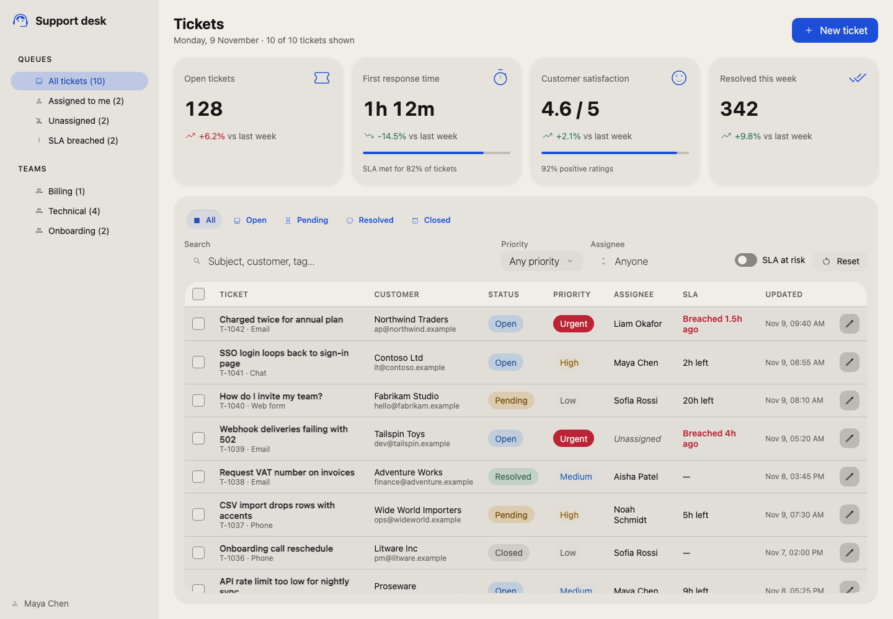
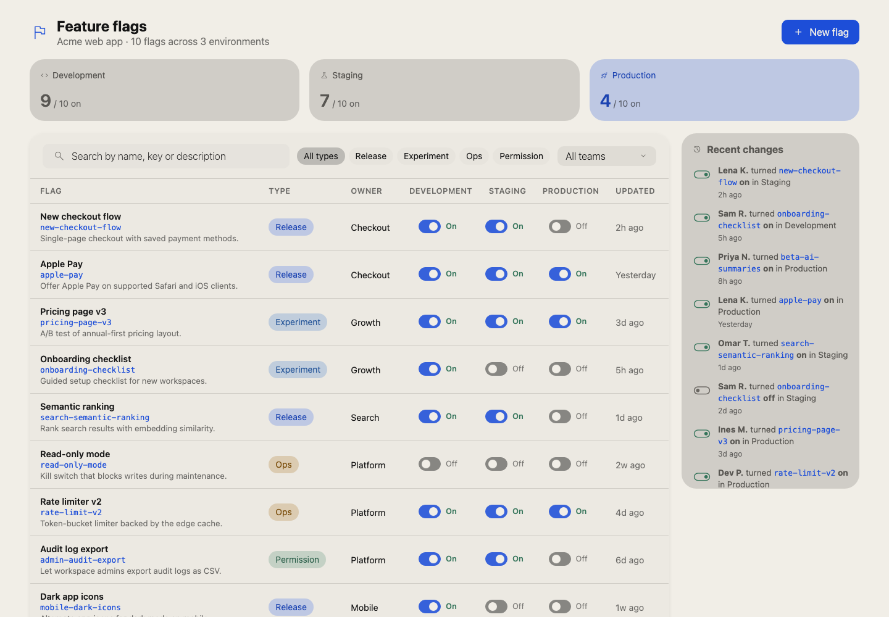

# Lastware Skills

Agent skills that make coding agents do one job well, built on the Lastware
open-source packages and checked for real before we call them done.

| Skill | Package | What it does | Status |
|---|---|---|---|
| [build-bref-interface](skills/bref-ui/build-bref-interface/SKILL.md) | [bref-ui](https://github.com/feuersteiner/bref-ui) `3.1.1` | Build a Svelte 5 dashboard, admin panel or internal tool from real Bref UI components, then verify it with `svelte-check` and a production build | Preview |

### Built with it

Each app below was built by a fresh agent from a single sentence, then checked
by the skill's verifier and reviewed from a screenshot. Source in [`demos/bref-ui/`](demos/bref-ui).

| | |
|---|---|
|  **Support dashboard:** *"Build a customer support dashboard with ticket management, filters, a sidebar and KPI cards."* |  **AI agent monitor:** *"Build a monitoring page for my AI agents: running jobs, progress bars, logs, stop button."* |
|  **File explorer:** *"Build a file explorer with a folder tree on the left and a preview on the right."* |  **Prompt library:** *"Build a prompt library: browse prompts by tag, search, edit in a dialog."* |
|  **Feature flags:** *"Build a feature flags dashboard with on/off switches per environment."* | |

Planned next: `script-to-cli` ([clinguini](https://github.com/feuersteiner/clinguini)),
`docs-to-task-context` ([contextrie](https://github.com/feuersteiner/contextrie)),
`enforce-project-rules` ([agent-tests](https://github.com/feuersteiner/agent-tests)).

## Install

**Claude Code**

```text
/plugin marketplace add mlgxiii/skills
/plugin install bref-ui@lastware
```

**Any agent that reads `SKILL.md` folders:** copy the skill folder into your
agent's skills directory, for example `.claude/skills/build-bref-interface/`.

## What makes a Lastware skill

Every skill:

1. Pins the package version it was tested with.
2. Uses only the APIs that package really exports.
3. Ships a verification step the agent must run, and never reports success it didn't observe.
4. Has an example project that CI runs from a clean install on every change.

## Layout

```text
skills/<package>/             # one Claude Code plugin per package (bref-ui@lastware, …)
  <skill>/
    SKILL.md                  # instructions the agent follows
    scripts/                  # verification helpers
    reference/                # extra detail the agent reads on demand
    example/                  # project CI verifies the skill against
demos/<package>/<demo>/       # more apps built with the package's skills, also verified in CI
scripts/repo.mjs              # repo checks CI runs on every change
```

Installing a plugin copies only its `skills/<package>/` folder. Demos are
never installed.

## Add a skill

1. Create `skills/<package>/<skill>/SKILL.md`. Its frontmatter `name` must
   equal the folder name, and it needs a `description`.
2. Add an `example/` project whose `package.json` has a `verify` script that
   runs the skill's verifier, for example `"verify": "node ../scripts/verify.mjs"`.
3. Register it in `.claude-plugin/marketplace.json`. For a new package, add a
   plugin with `"source": "./skills/<package>"`, `"strict": false` and
   `"skills": ["./<skill>"]`. For an existing package, append `"./<skill>"`
   to that plugin's `skills`.
4. Add a row to the skills table above that links its `SKILL.md`.
5. Optional: add demos under `demos/<package>/<demo>/`, each with a `verify` script.

Then run `node scripts/repo.mjs check`. It lists every step you missed. CI runs
the same check and verifies every example and demo it finds, with no workflow
edits needed.

The underlying packages live in their own repositories. This repo depends on
them through npm and never vendors their code.

## License

MIT
