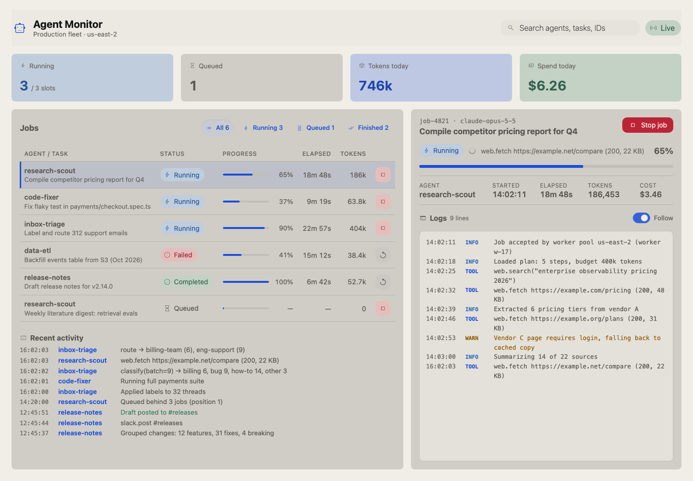
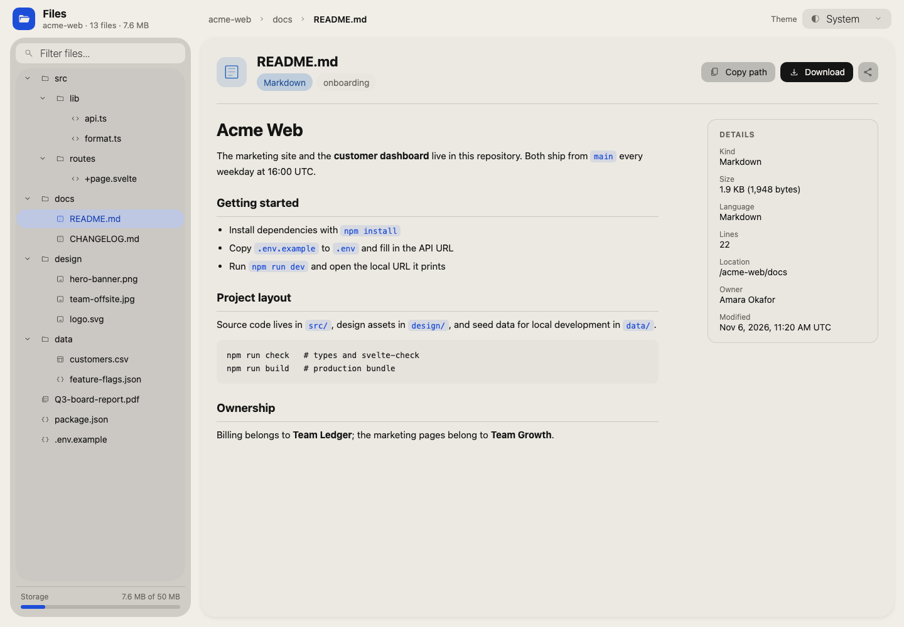
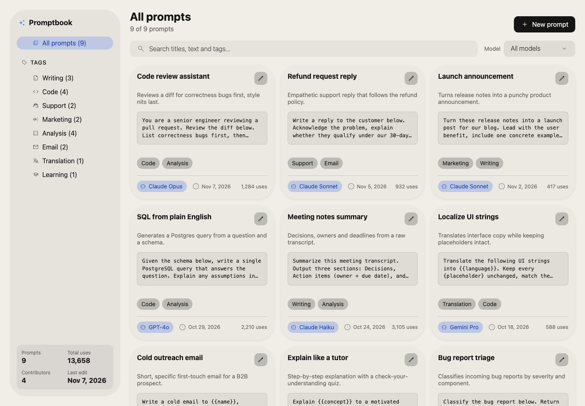

# Lastware Skills

Agent skills that make coding agents do one job well, built on the Lastware
open-source packages and checked for real before we call them done.

| Skill | Package | What it does | Status |
|---|---|---|---|
| [build-bref-interface](skills/bref-ui/build-bref-interface/SKILL.md) | [bref-ui](https://github.com/feuersteiner/bref-ui) `3.1.1` | Build a Svelte 5 dashboard, admin panel or internal tool from real Bref UI components, then verify it with `svelte-check` and a production build | Preview |

### Built with it

Each app below was built by a fresh agent from a single sentence, then checked
by the skill's verifier and reviewed from a screenshot. Source in [`demos/`](demos).

| | |
|---|---|
|  **Support dashboard:** *"Build a customer support dashboard with ticket management, filters, a sidebar and KPI cards."* |  **AI agent monitor:** *"Build a monitoring page for my AI agents: running jobs, progress bars, logs, stop button."* |
|  **File explorer:** *"Build a file explorer with a folder tree on the left and a preview on the right."* |  **Prompt library:** *"Build a prompt library: browse prompts by tag, search, edit in a dialog."* |
|  **Feature flags:** *"Build a feature flags dashboard with on/off switches per environment."* | |

Planned next: `script-to-cli` ([clinguini](https://github.com/feuersteiner/clinguini)),
`docs-to-task-context` ([contextrie](https://github.com/feuersteiner/contextrie)),
`enforce-project-rules` ([agent-tests](https://github.com/feuersteiner/agent-tests)).

## Install

**Claude Code**

```text
/plugin marketplace add lastware/skills
/plugin install bref-ui@lastware
```

**Any agent that reads `SKILL.md` folders:** copy the skill folder into your
agent's skills directory, for example `.claude/skills/build-bref-interface/`.

## What makes a Lastware skill

Every skill:

1. Pins the package version it was tested with.
2. Uses only the APIs that package really exports.
3. Ships a verification step the agent must run, and never reports success it didn't observe.
4. Has an example project that CI runs from a clean install on every change.

## Layout

```text
skills/<package>/<skill>/
  SKILL.md      # instructions the agent follows
  scripts/      # verification helpers
  reference/    # extra detail the agent reads on demand
  example/      # project CI verifies the skill against
demos/          # more apps built with the skills, also verified in CI
```

The underlying packages live in their own repositories. This repo depends on
them through npm and never vendors their code.

## License

MIT
