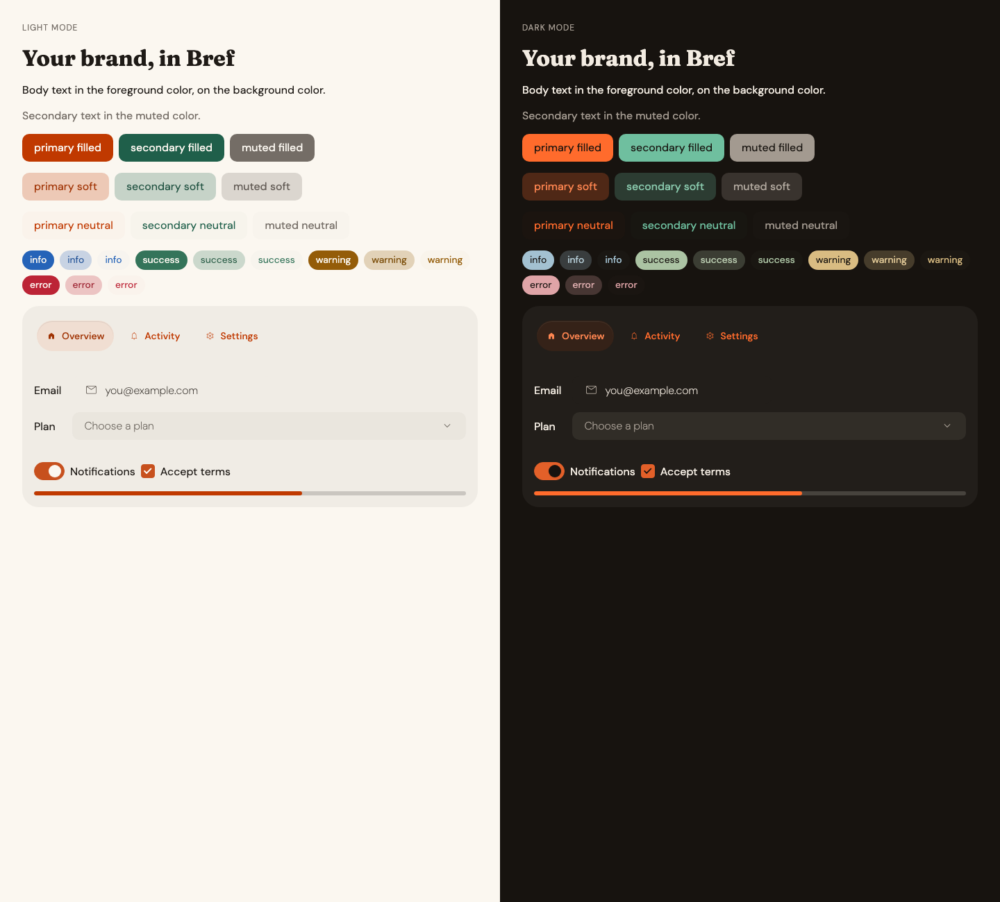

# Skills

Agent skills that check their own work.

Grouped by what they're built on. Copy only the skill you need.

## Bref UI

[Bref UI](https://github.com/feuersteiner/bref-ui) is a Svelte 5 component library.

### bref-brand-theme

Makes a Bref UI app look like your brand, and keeps it readable.

Most brand colors fail contrast somewhere. Bright orange is the classic case: white text on `#ff6b2c` is 2.7:1, well under the 4.5:1 that WCAG asks for. You don't notice until someone can't read your buttons.

So the skill doesn't just copy your colors into Bref. It rebuilds all 44 text and background pairs Bref draws, in light and dark mode, and checks each one. When a color fails, it keeps the hue and changes only the lightness. That orange becomes `#c03900`: still orange, now 5.1:1.



Does it work? I gave a fresh agent one sentence: "Make this app match the svelte.dev brand." It found Svelte's colors, dark mode and fonts, and picked `#d63400` for light mode. svelte.dev itself uses `#d43008`.

[The skill](skills/bref-ui/bref-brand-theme/SKILL.md) · [The example above](skills/bref-ui/bref-brand-theme/example)

## Agent tests

[agent-tests](https://github.com/feuersteiner/agent-tests) checks code against rules written in plain words: a `TEST.md` that says the rule, and a `test.yaml` that checks it. It's early: not released yet, so these skills need [Bun](https://bun.sh) and a checkout of it (each skill says how).

### agent-test-writer

Turns a rule your coding agent keeps breaking into a test, so it stops getting broken.

You write "never call fetch() in components" in CLAUDE.md. The agent reads it, agrees, and a week later calls fetch() in a component. Instructions are suggestions. Tests aren't.

So the skill turns the rule into an agent test: a `TEST.md` that says the rule in plain words, and a `test.yaml` that checks it with a regex, or with a model when the rule needs judgment. Before it trusts the test, it proves it: labeled examples that must fail, pass and be skipped, and one deliberate break to show the test can catch anything at all. Then it checks your code and reports each violation by file and line.

Does it work? I gave a fresh agent a small app and one sentence: "My agent keeps calling fetch() directly in components even though CLAUDE.md says not to." It wrote the test and passed 8 of 8 labeled examples. It found both violations, including a `window.fetch`, and ignored a comment that said "must not call fetch()". It also pointed out that CLAUDE.md's rule was wider than the request and asked whether to test that too.

Rules that need a model also need an OpenAI and an Anthropic key; regex-only rules don't.

[The skill](skills/agent-tests/agent-test-writer/SKILL.md)

## Install

A skill is a folder. Copy it to where your agent looks for skills:

```sh
git clone --depth 1 https://github.com/mlgxiii/skills.git /tmp/skills
cp -R /tmp/skills/skills/bref-ui/bref-brand-theme .claude/skills/       # or
cp -R /tmp/skills/skills/agent-tests/agent-test-writer .claude/skills/
```

Then ask: *"Make this app match our brand: https://our-site.example"*, or *"Make this a rule: …"*.

## Why the checks

Tell a model "keep text readable" and it agrees, then doesn't. Run a check and hand it the failures, and it fixes them. Every skill here works that way, and every check runs in CI (`npm test`).

More skills are coming, one at a time. MIT.
